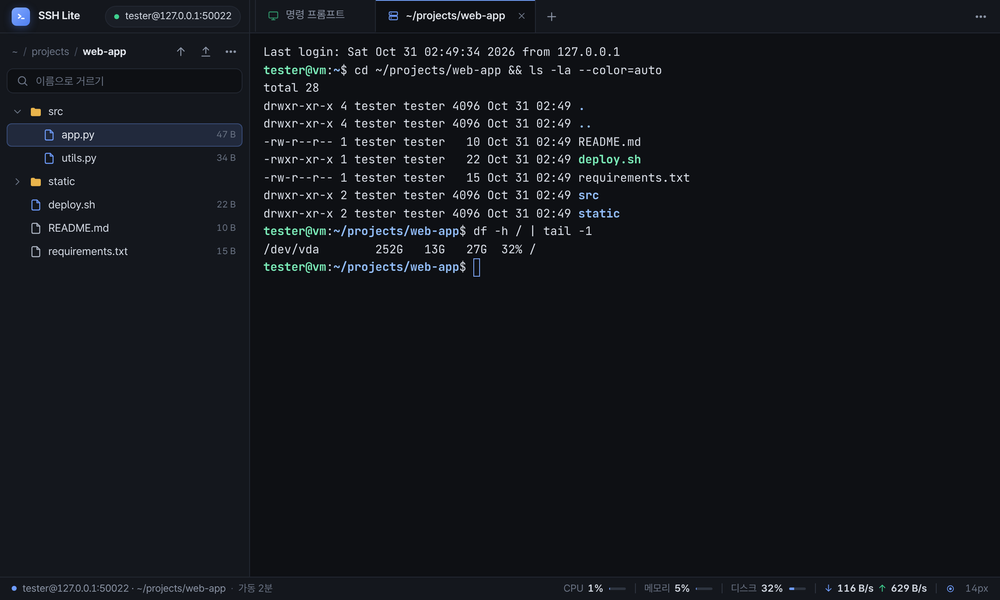
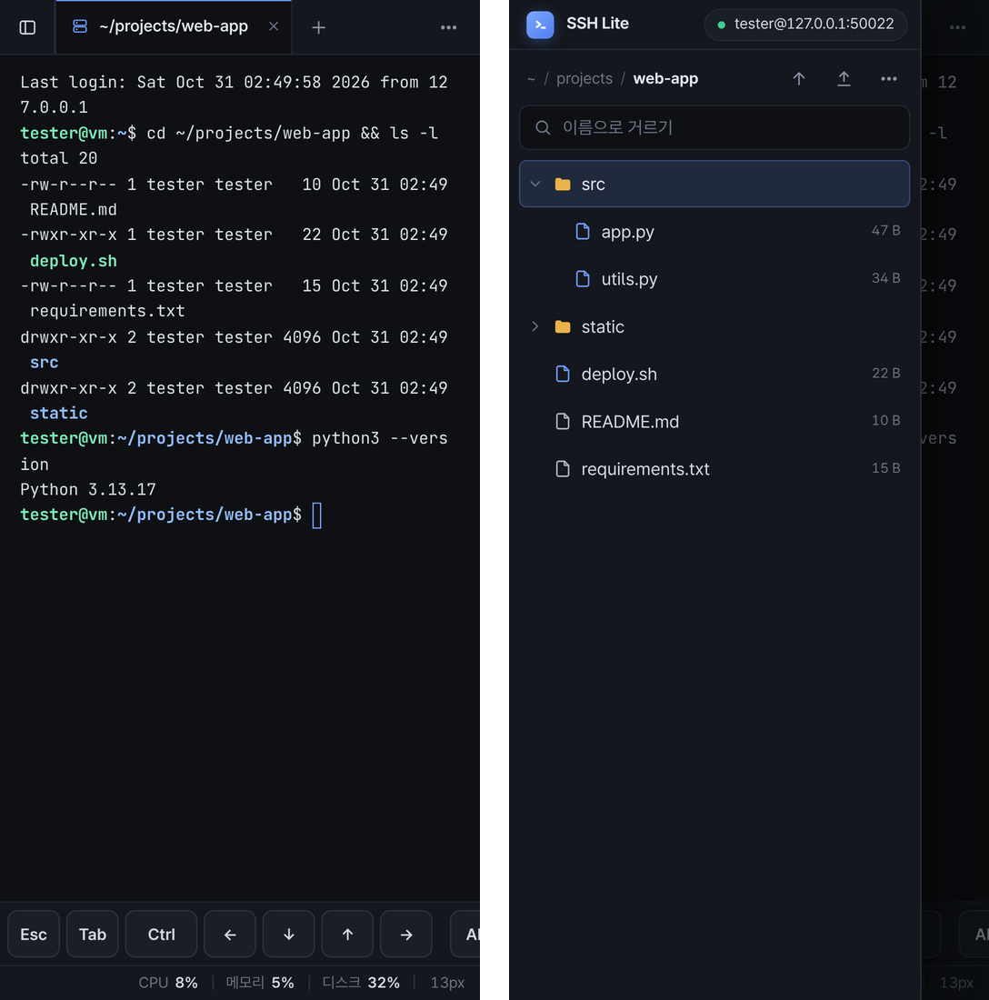

# SSH Lite

한 창 안에 **왼쪽은 서버 파일 트리**, **오른쪽은 터미널 탭**이 있는 가벼운 SSH · SFTP 접속 도구예요. Windows와 안드로이드(갤럭시 등)에서 돼요.



- **비밀번호는 처음 한 번만**: 처음 접속할 때 SSH 키를 만들어 서버에 등록해요. 다음부터는 바로 연결돼요.
- **파일 주고받기**: 탐색기에서 트리로 끌어다 놓으면 업로드돼요. 서버 파일을 더블클릭하면 내 PC 프로그램으로 열리고, 저장하면 자동으로 다시 올라가요.
- **터미널 탭**: 서버 터미널을 여러 개 열 수 있어요. Windows에서는 내 PC 명령 프롬프트와 PowerShell 탭도 돼요. 탭 이름에 지금 폴더와 실행 중인 명령이 보여요.
- **맨 아래 상태 줄**: 서버 CPU·메모리·디스크·네트워크를 보여줘요 (맥·리눅스 서버). 연결이 끊기면 자동으로 다시 연결해요.
- **폰 앱**: 화면을 밀면 파일 서랍이 나와요. 특수 키 줄이 있고, 길게 눌러 붙여넣기와 구간 선택 복사를 할 수 있어요.

<p align="center"></p>

## 실행

[`release/`](release) 폴더에서 [`SSH-Lite.exe`](release/SSH-Lite.exe)(Windows) 또는 [`SSH-Lite.apk`](release/SSH-Lite.apk)(갤럭시·안드로이드)를 받으세요. 파일을 누른 뒤 오른쪽 위의 다운로드(↓) 버튼을 누르면 돼요.

`SSH-Lite.exe`를 더블클릭하면 끝이에요. 설치할 것도 없어요.
켜면 바로 **내 PC 명령 프롬프트** 탭이 뜨고, 왼쪽 접속 카드에 서버 주소·포트·사용자를 넣고 **연결**을 누르면 서버 탭이 열려요. 한 번 넣은 서버 정보는 기억해요.

처음 한 번만 비밀번호를 입력하면, 앱이 알아서 SSH 키를 만들어 서버에 등록해요.
그다음부터는 이 앱도, cmd의 `ssh -p <포트> <사용자>@<서버>`도 비밀번호를 묻지 않아요 (같은 `~/.ssh/id_ed25519` 키를 써요).
"앱을 켜면 바로 연결"을 체크해 두면 실행하자마자 터미널이 떠요.

"Windows의 PC 보호" 파란 창이 뜨면 **추가 정보 → 실행**을 누르세요. 서명(인증서)이 없는 exe라서 처음 한 번 뜨는 경고예요.

## 터미널 탭

| 하고 싶은 일 | 방법 |
|---|---|
| 새 탭 | 탭 옆 **+** 버튼 → 서버 터미널 / 명령 프롬프트 / PowerShell 중 선택 |
| 같은 종류 탭 하나 더 | **Ctrl+Shift+T** 또는 탭 막대 빈 곳 더블클릭 (지금 탭이 서버면 서버, 내 PC면 내 PC) |
| 다른 탭으로 | 탭 클릭, **Ctrl+Tab** / **Ctrl+Shift+Tab**, **Alt+1~9** |
| 탭 순서 바꾸기 | 탭을 **끌어서** 원하는 자리에 놓기, 또는 **Ctrl+Shift+PageUp / PageDown** |
| 탭 닫기 | 탭의 ✕, 탭을 마우스 가운데 버튼으로 클릭, **Ctrl+Shift+W**, 또는 그 탭에서 `exit` |

탭을 바꿔도 이전 탭은 그대로 살아 있어요 (실행 중인 프로그램도 계속 돌아가요).
서버 탭은 서버 아이콘(파란색), 내 PC 탭은 모니터 아이콘(초록색)이에요.

**실행 중인 명령 표시**: 명령이 돌아가는 동안 탭 이름이 그 명령(예: `top`, `vim notes.txt`)으로 바뀌고 ▶ 아이콘이 깜박여요.
- 내 PC 명령 프롬프트: 따로 설정할 것 없어요.
- 서버 탭: **기본으로 켜져 있어요.** 처음 연결할 때 서버 `~/.bashrc` 끝에 몇 줄을 추가해요(원본은 `~/.bashrc.ssh-lite.bak`에 백업). 끄려면 **⋯ 메뉴 → 탭 이름에 폴더·명령 표시: 켜짐**을 누르세요. 추가했던 줄만 지워지고, 그다음부터는 다시 켜지 않아요. 서버 기본 셸이 bash(오래된 버전 포함) 또는 zsh일 때 동작해요. 설정하지 못하면 이유를 알림으로 알려주고, ⋯ 메뉴에 "켜지 못함"으로 보여요. 서버 연결이 끊기거나 연결을 끊어도 **내 PC 탭은 그대로** 남아요.
보고 있지 않은 탭에 새 출력이 오면 탭에 파란 점이 떠요. 탭 이름은 그 탭의 현재 폴더로 자동으로 바뀌어요.

## 파일 주고받기

| 하고 싶은 일 | 방법 |
|---|---|
| 내 PC → 서버 | 윈도우 탐색기에서 파일/폴더를 **왼쪽 트리의 폴더 위에 끌어다 놓기** (빈 곳에 놓으면 맨 위 폴더로). 위쪽 업로드 버튼도 있어요 |
| 서버 파일 바로 고치기 | 파일 **더블클릭** → 내 PC 기본 프로그램(메모장, VS Code 등)으로 열려요. **저장하면 서버에 자동으로 올라가요.** 우클릭 → 다른 프로그램으로 열기도 있어요 |
| 서버 → 내 PC | 우클릭 → 다운로드. `다운로드` 폴더에 저장되고, 알림의 **폴더 열기**로 바로 볼 수 있어요 |
| 서버 안에서 옮기기 | 트리 안에서 항목을 다른 폴더 위로 끌어다 놓기, 또는 우클릭 → 다른 폴더로 옮기기. 잘못 옮겼으면 알림의 **되돌리기** |
| 터미널을 그 폴더로 | 폴더 우클릭 → 터미널에서 이 폴더로 이동 |

같은 이름이 있으면 올릴 때는 덮어쓸지 물어보고, 받을 때는 `이름 (1).txt`처럼 새 이름으로 저장해요.
전송 중에는 맨 아래 상태 줄에 진행률, **속도와 남은 시간**(예: `48 MB/s · 6초 남음`)이 보이고 ✕로 취소할 수 있어요. 폴더를 통째로 보낼 때도 전체 기준으로 계산해요.

**이름으로 거르기**: 트리 바로 위에 항상 있는 칸에 글자를 치면 그 글자가 들어간 것만 남아요 (펼쳐 둔 폴더 안까지). 트리를 누른 상태에서 바로 글자를 쳐도 돼요. Esc나 ✕로 지워요.

터미널에서 명령이 끝나면 트리도 저절로 새로고침돼요 (`touch`·`mv`·`rm` 한 결과가 바로 보여요). 단축키 목록은 **F1** 또는 ⋯ 메뉴 → 단축키 · 사용법.

트리 따라가기(기본 켜짐, 왼쪽 위 ⋯ 메뉴나 맨 아래 상태 줄 오른쪽 ◎ 버튼으로 켜고 끔)가 켜져 있으면 트리가 **서버 탭의 현재 폴더를 따라가요**. 터미널에서 `cd` 하거나 탭을 바꾸면 트리도 그 폴더로 바뀌어요.

**단축키** (트리에서): 방향키 이동 · Enter 열기(편집) · F2 이름 바꾸기 · Delete 삭제 · F5 새로고침 · Backspace 상위 폴더 · Ctrl/Shift+클릭 여러 개 선택
**터미널**
- 복사: 드래그로 선택 후 **오른쪽 클릭** / Ctrl+C(선택이 없으면 평소처럼 중단) / Ctrl+Insert
- 붙여넣기: 선택 없이 **오른쪽 클릭** / Ctrl+V / Shift+Insert / Ctrl+Shift+V (여러 줄은 엔터를 눌러야 실행돼요)
- **Home / End** 줄 처음·끝, **Ctrl+← / →** 단어 단위 이동 (zsh처럼 이 키를 모르는 셸에서도 돼요)
- 그 밖에: **Ctrl+Shift+F 찾기** · **Ctrl+휠 / Ctrl+= / Ctrl+- 글자 크기** (Ctrl+0 원래대로) · 주소는 **Ctrl+클릭**하면 브라우저로 열려요

## 서버 사용량

맨 아래 상태 줄 오른쪽에 서버의 **CPU · 메모리 · 디스크** 사용률과 **네트워크 속도**(↓ 받기 / ↑ 보내기)가, 왼쪽 접속 정보 옆에 서버 **가동 시간**이 보여요 (75% 넘으면 노란색, 90% 넘으면 빨간색). 마우스를 올리면 자세한 크기가 나와요. 창이 좁거나 파일을 주고받는 중에는 네트워크 속도는 잠깐 숨겨요.
오른쪽 끝의 ◎ 버튼은 트리 따라가기(파란색이면 켜짐), `14px`는 글자 크기예요 (마우스를 올리면 터미널 크기도 보여요).
연결하자마자 한 번, 그다음 10초에 한 번 아주 짧은 명령만 실행해요. 서버가 맥이면 `ps`/`vm_stat`/`df`, Linux면 `/proc`/`df`로 읽어요. 끄려면 **⋯ 메뉴 → 상태 줄에 서버 사용량 표시**.
일부만 읽히면 읽힌 것만 보여줘요. 하나도 못 읽으면 **사용량 ⚠** 버튼이 뜨는데, 누르면 이유와 서버가 실제로 돌려준 내용이 보여요 (30초마다 다시 시도하고, "다시 시도"로 바로 해볼 수도 있어요).

## 연결이 끊기면

자동으로 1, 2, 4, 8… 최대 30초 간격으로 다시 연결해요 (SSH 키가 등록돼 있으면 아무것도 누를 필요 없어요).
다시 연결되면 서버 탭이 **화면 내용 그대로** 살아나고 원래 있던 폴더로 돌아가요. 기다리기 싫으면 터미널 위의 **지금 연결**을 누르세요.
끊긴 동안 편집기에서 저장한 서버 파일은, 다시 연결되면 그때 올라가요.

## 갤럭시(안드로이드) 앱

[`release/SSH-Lite.apk`](release/SSH-Lite.apk) 하나로 설치해요. 화면은 PC 앱과 같고, 폰에 맞게 바뀐 점만 적어요. Android 10 이상에서 돼요.

**설치**
1. `SSH-Lite.apk`를 폰으로 옮겨서(카카오톡 나에게 보내기, 구글 드라이브 등) 눌러요.
2. "출처를 알 수 없는 앱" 설치를 허용하라고 나오면, 파일을 연 앱(내 파일, Chrome 등)에 허용해 주세요.
3. Play 프로텍트 경고가 뜨면 자세히 보기에서 그래도 설치를 고르세요. 스토어에 올리지 않은 앱이라 뜨는 경고예요.
4. 새 버전도 같은 방법으로 설치하면 설정과 키가 그대로 남아요 (같은 서명 키로 만들어서 '업데이트'로 설치돼요).

**쓰는 법**
| 하고 싶은 일 | 방법 |
|---|---|
| 서버 파일 트리 보기 | 화면을 **오른쪽으로 밀기** (왼쪽 절반 어디서든), 또는 왼쪽 위 ▯ 버튼. 닫을 때는 왼쪽으로 밀기, 바깥 누르기, 뒤로 가기 |
| 폴더 펼치기 / 파일 열기 | 폴더는 누르면 펼쳐져요. 파일은 **두 번 누르면** 폰으로 받아서 폰 앱으로 열어요 |
| 다운로드·이름 바꾸기·삭제 | 항목을 **길게 누르기** |
| 여러 개 한 번에 | 길게 누르기 → **여러 개 선택** → 항목을 눌러 체크(다시 누르면 빠짐) → 아래에서 **옮기기 · 받기 · 삭제** |
| 다른 폴더로 옮기기 | 길게 누르기 → **다른 폴더로 옮기기…** → 옮길 폴더 누르기 (맨 위 폴더는 목록 빈 곳) → **여기로 옮기기**. 폰에서는 끌어서 옮기기가 없어서 실수로 옮겨지지 않아요 |
| 폰 파일 올리기 | 트리 위 업로드 버튼 → 폰 파일 고르기 (여러 개 가능) |
| Esc·Tab·Ctrl·방향키·Enter·Home/End | 터미널 아래 **키 줄** (옆으로 밀면 Alt·PgUp/PgDn·`\|` `~` `/` `-`·붙여넣기도 있어요) |
| Ctrl+C 같은 조합 | 키 줄의 **Ctrl**을 누르고(파랗게 켜짐) 다음 글자 하나 입력 |
| 글자 크기 | 터미널에서 **두 손가락으로 벌리기/오므리기**, 또는 맨 아래 줄 오른쪽 끝의 글자 크기(예: `13px`) 누르기 |
| 붙여넣기 | 터미널을 **길게 누르면** 메뉴가 떠요 (붙여넣을 내용 미리보기). 키 줄의 붙여넣기 버튼도 있어요. 여러 줄은 엔터를 눌러야 실행돼요 |
| 글자 복사 | 복사할 곳을 길게 누르기 → **구간 선택해서 복사** → 그 낱말부터 선택돼요. 손가락으로 그으면 그 범위, 선택 끝을 끌면 늘어나요 (위·아래 끝으로 끌면 화면이 따라 움직여요) → 아래 **복사** |

- 받은 파일은 폰의 **다운로드/SSH Lite** 폴더에 저장돼요. 같은 이름이 있으면 폰이 `이름 (1)`처럼 바꿔요.
- 폰은 PC와 SSH 키가 따로예요. 폰에서 처음 한 번만 비밀번호를 넣으면 폰 전용 키를 만들어 서버에 등록하고, 다음부터는 바로 연결돼요.
- 서버 파일을 폰에서 고쳐도 서버에 자동으로 다시 올라가지는 않아요. 고친 파일은 업로드 버튼으로 올려 주세요.
- 내 PC 명령 프롬프트/PowerShell 탭은 폰에는 없어요.
- 앱이 갑자기 멈추면 그 이유를 저장해 뒀다가 다음에 켤 때 보여줘요. **복사**를 눌러서 보내주시면 고칠 수 있어요.
- 서버에 연결된 동안은 알림 줄에 **"서버에 연결돼 있어요"** 알림이 떠 있어요. 이 알림이 있어야 다른 앱을 쓰는 동안 폰이 앱을 얼리지 않아서 연결이 안 끊겨요 (처음에 알림 허용을 물어보면 **허용**). 연결을 끊거나 앱을 닫으면 사라져요.
- 그래도 끊기면 폰 설정에서 SSH Lite를 배터리 최적화에서 빼 주세요 (삼성 폰: 설정 → 애플리케이션 → SSH Lite → 배터리 → **제한 없음**. 기종마다 이름이 조금 달라요).
- 끊겨도 서버에서 돌리던 일을 이어가고 싶으면 서버에서 `tmux`(또는 `screen`) 안에서 작업하세요. 다시 연결한 뒤 `tmux attach` 하면 그대로 이어져요.
- 뒤로 가기를 눌러도 앱은 뒤로 숨기만 하고 연결은 유지해요. 폰이 앱을 정리해서 연결이 끊겼으면 돌아왔을 때 자동으로 다시 연결해요.

다시 만들려면 `android/build.sh`를 실행하세요 (Ubuntu 기준 필요한 도구는 파일 맨 위에 적어 뒀어요).
SSH는 JSch, Ed25519·Curve25519 암호는 Bouncy Castle에서 필요한 부분만 넣었어요 (`android/libs/`, 라이선스는 [THIRD_PARTY_NOTICES.md](THIRD_PARTY_NOTICES.md)).

## 코드를 고쳐서 다시 만들 때 (선택)

Python 3.11~3.13을 설치한 뒤 `build_exe.bat`을 더블클릭하면 `dist\SSH-Lite.exe`가 새로 만들어져요.

**내 서버 정보를 미리 넣어서 만들기**: 저장소 맨 위에 `defaults.local.json`을 만들어 두세요.
그러면 `build_exe.bat`과 `android/build.sh`로 만든 앱이 처음 켤 때부터 그 서버로 채워져 있어요.
안드로이드는 `SSH-Lite-personal.apk`가 따로 만들어져요. 이 파일은 `.gitignore`에 들어 있어서 저장소에는 올라가지 않아요.

```json
{"host": "myserver.example.com", "port": 22, "user": "me"}
```
exe 없이 바로 실행하려면 `pip install -r requirements.txt` 후 `ssh_lite.pyw`를 더블클릭하세요 (`ui` 폴더가 옆에 있어야 해요).

## 알아두면 좋은 것

- 창이 화면보다 크면(작은 노트북, 배율 150% 등) 켤 때 화면 안에 들어오게 자동으로 줄여요. 그래야 맨 아래 상태 줄이 작업 표시줄 뒤로 숨지 않아요.
- 화면은 Windows에 들어 있는 Edge WebView2로 그려요. 창이 안 뜨면 Microsoft의 "WebView2 Runtime"을 설치하세요.
- 서버에서 내 PC 탐색기로 **끌어내는 것**은 안 돼요 (WebView2가 지원하지 않아요). 더블클릭이나 우클릭 다운로드를 쓰세요.
- 파일을 주고받는 중이거나, 편집한 서버 파일이 아직 안 올라갔을 때 창을 닫으면 **먼저 물어봐요** (그냥 닫혀서 사라지지 않게).
- 삭제처럼 되돌릴 수 없는 확인 창은 **취소**가 기본이에요. Enter를 눌러도 지워지지 않아요.
- 비밀번호는 어디에도 저장하지 않아요. SSH 키는 `C:\Users\<사용자>\.ssh\id_ed25519`에 만들어지고, 서버에는 공개키만 등록돼요.
- 설정은 `C:\Users\<사용자>\.ssh_lite.json`에 저장돼요.
- 터미널 화면 엔진은 xterm.js예요. 글꼴은 Pretendard와 JetBrains Mono를 함께 넣었어요.

## 라이선스

[MIT](LICENSE). 누구나 자유롭게 쓰고, 고치고, 다시 배포할 수 있어요. 저작권 표시만 남겨 주세요.
함께 들어 있는 외부 코드(xterm.js, JSch, Bouncy Castle, 글꼴, Windows exe 안의 Python 라이브러리)의 라이선스는 [THIRD_PARTY_NOTICES.md](THIRD_PARTY_NOTICES.md)에 정리해 뒀어요.
